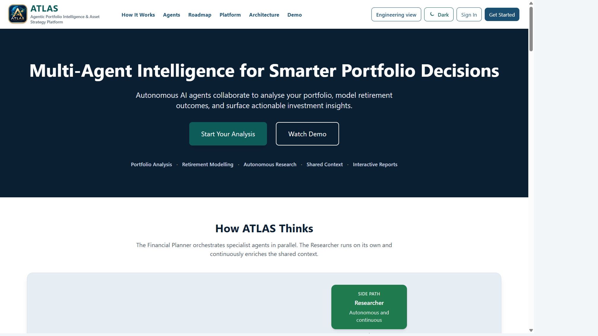
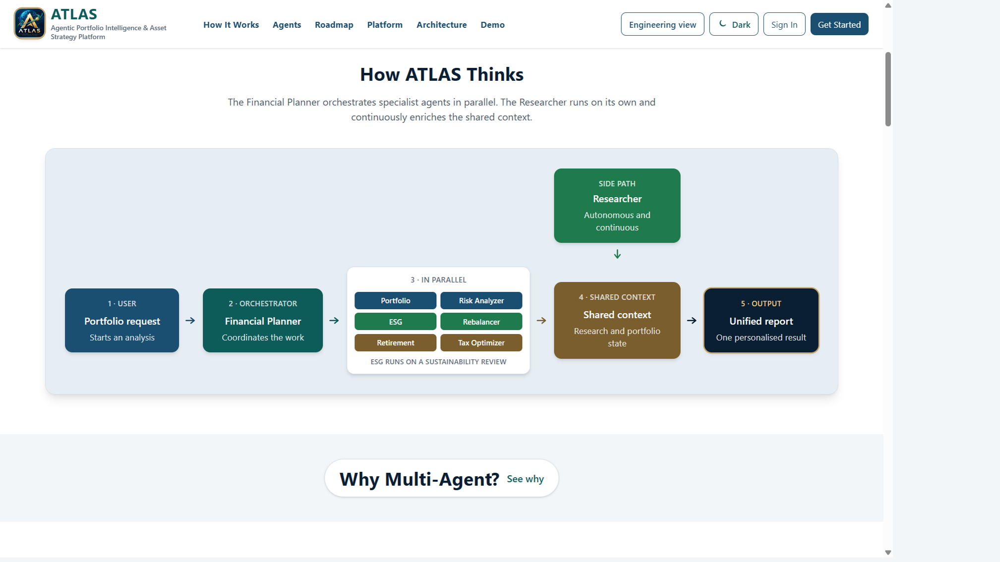
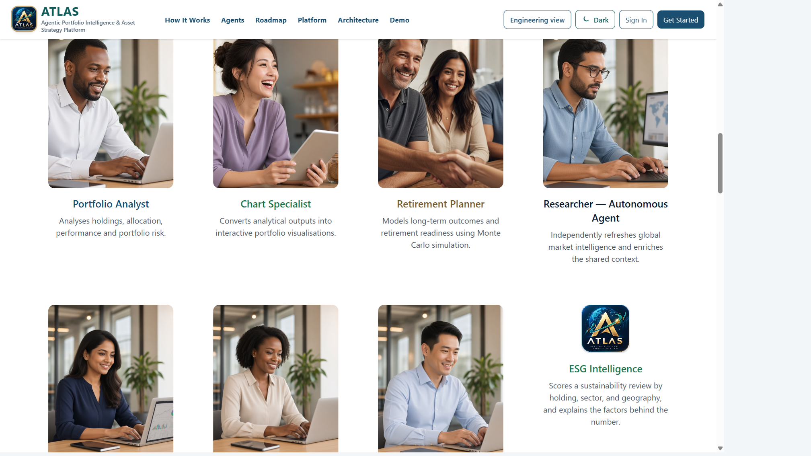
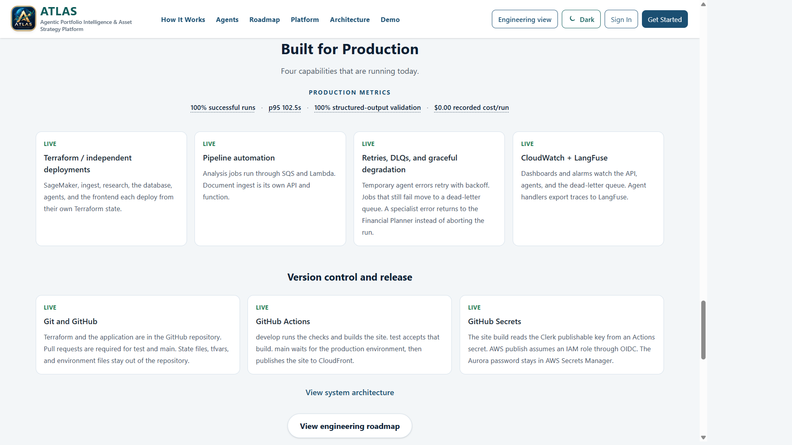

# ATLAS

**Agentic Portfolio Intelligence & Asset Strategy Platform**

ATLAS is a multi-agent investment intelligence product. A signed-in person can keep portfolio accounts, ask for an analysis, and receive a written report, charts, and a retirement projection. A sustainability review scores the current holdings with a documented factor model. International coverage classifies listings by region and venue.

ATLAS provides educational and analytical insights. It does not provide regulated financial advice, and it does not execute trades.

The live product is at [d26g4bgouyikfd.cloudfront.net](https://d26g4bgouyikfd.cloudfront.net).

This repository is a public showcase. It contains the product description, diagrams, screenshots of public pages, the technology stack, and selected aggregate metrics. Application source, infrastructure code, prompts, and deployment configuration stay in a private repository.

## Product

A request goes to an orchestrator, the Financial Planner. Specialist agents then work in parallel:

- **Portfolio Analyst** writes the narrative and scores the report.
- **Chart Specialist** returns chart data the report page can draw.
- **Retirement Planner** models retirement readiness.
- **ESG Intelligence** runs on a sustainability review. The score is a factor model, not a vendor rating.
- **Researcher** refreshes shared market context on its own path. It is not called inside the analysis job.

Risk Analyzer, Rebalancer, and Tax Optimizer exist as separate specialists. They are not part of the live analysis fan-out. Options strategy analysis is still planned.

## Technology stack

| Layer | What it uses |
| --- | --- |
| Interface | React and Next.js |
| Sign-in | Clerk |
| Analysis runtime | AWS Lambda, with SQS carrying one job per analysis |
| Portfolio data | Aurora PostgreSQL, reached through the Data API |
| Shared research | A vector index and a SageMaker embedding model |
| Model | Amazon Bedrock, Amazon Nova Pro |
| Market prices | Polygon end-of-day prices for US-listed symbols |
| Observability | CloudWatch for logs and alarms, Langfuse for analysis traces |
| Infrastructure | Terraform, one state file per stack, kept in the private repository |
| Release | GitHub Actions promotes a site build through develop, test, and main |

## Architecture

The diagrams in [docs/architecture.md](docs/architecture.md) show the analysis path and the research side path. They use product roles, not resource identifiers.

The release path is in [docs/workflows.md](docs/workflows.md). A reviewer accepts the production environment before the static site is published. That workflow publishes the site. It does not change infrastructure or function code.

## Selected metrics

These figures are aggregates from saved analyses and Langfuse traces, read on 15 October 2026. They are not a benchmark, and the recorded model cost is not the AWS bill.

| Metric | Value | What it counts |
| --- | --- | --- |
| Combined score | 56 / 100 | Judge average across 7 saved reports |
| Groundedness | 56 / 100 | Same 7 reports |
| Citation correctness | 66 / 100 | Same 7 reports |
| Structured-output validity | 100% | 7 of 7 chart payloads the report page can draw |
| Agent completion rate | 100% | 8 of 8 finished jobs. Pending jobs that never started are excluded |
| Unsupported-claim rate | 43% | Judge average across 7 saved reports |
| Retrieval hit rate | 1 of 2 | Portfolio Analyst traces that called the vector index and finished. This is not a passage hit rate |
| p95 latency | 102.5s | Financial Planner trace, 2 runs |
| Recorded cost/run | $0.00 | Langfuse average because Nova Pro has no price in this project. 12,541 tokens across 7 model calls |

The public production strip shows the same completion, latency, structured-output, and recorded-cost figures:

The full notes are in [docs/metrics.md](docs/metrics.md).

## Rights

© 2026 ATLAS. All rights reserved.

This repository does not grant a licence to copy, modify, or redistribute its text, diagrams, or images. There is no open-source licence.
