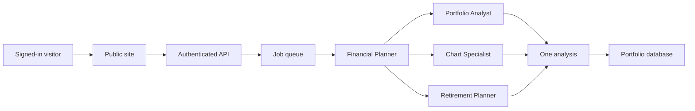
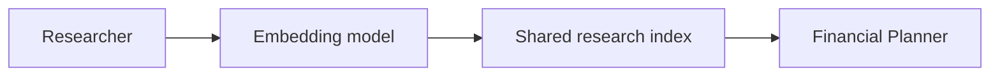

# Architecture

These diagrams describe how ATLAS is arranged. They omit account identifiers, resource names, network addresses, and configuration.

## Analysis path

A signed-in request becomes one job. The Financial Planner coordinates the specialists that belong to that job. The Portfolio Analyst, Chart Specialist, and Retirement Planner run together. Their results are assembled into one analysis.

A sustainability review also asks ESG Intelligence to score the current holdings. That score uses a documented factor model. It is not a third-party ESG rating, and it is not run on every analysis.

If a holding has no allocation data, the planner asks an instrument tagger to classify it before the specialists run. When every holding already has an allocation, that step is skipped.

## Research side path

The Researcher is separate from the analysis job. It writes shared research into a vector index. The Financial Planner reads what is already in that index.

A scheduled two-hour research run can be configured. That schedule is not turned on. Research runs when it is requested, and the analysis job does not call the Researcher itself.

## Data

| Store | What it holds |
| --- | --- |
| Static site | The public pages, served through a CDN |
| Portfolio database | Accounts, holdings, settings, and reports for the signed-in user |
| Research index | Shared market research as embeddings |
| Secret store | The database password, read when a function runs |

Sign-in is checked at the API. Queries for accounts and jobs use the signed-in user. There is no database row-level security policy.

## What stays private

Application source, infrastructure definitions, agent prompts, and deployment settings are not in this repository.
