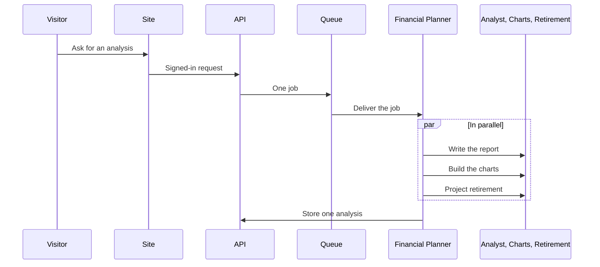
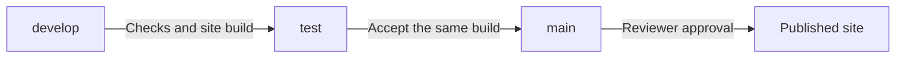

# Workflows

These are the product workflows a reviewer can follow without the private repository. They do not include commands, credentials, or resource identifiers.

## Analysis

Temporary specialist errors are retried. A job that still fails after repeated delivery moves to a dead-letter queue. A specialist error returns to the Financial Planner instead of discarding the rest of the run.

Under 30 out of 100, the Portfolio Analyst replaces the report text with an apology and withholds it.

## Release

| Stage | What happens |
| --- | --- |
| develop | Local checks run and the site is built. Nothing in the cloud changes. |
| test | The same checks run again. A passing build is accepted as a candidate. Nothing in the cloud changes. |
| main | A reviewer accepts the production environment. The built site is then published and the CDN cache is invalidated. |

Pull requests are required into test and main. The build reads its public sign-in key from a GitHub Actions secret. Cloud publish uses short-lived credentials from an identity provider. There is no long-lived cloud access key in GitHub. The database password stays in the cloud secret store.

The release publishes the static site. It does not apply infrastructure changes, and it does not replace function code.
